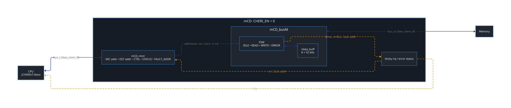
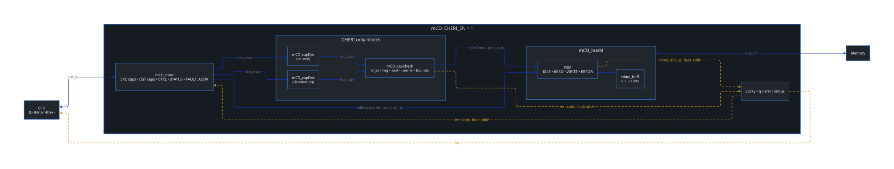

# mon-CHERI-DMA (mCD)

A single-channel, memory-to-memory DMA engine in SystemVerilog that enforces **[CHERIoT](https://github.com/microsoft/cheriot-ibex.git) capabilities** in hardware. Source and destination are given as CHERIoT capabilities rather than raw addresses. mCD checks the whole transfer against both capabilities before issuing any bus request, then copies data with CHERI tags preserved or stripped according to the capabilities' permissions.

mCD targets the [CHERIoT](https://cheriot.org) SoC and connects through the Ibex data-memory interface (`req`/`gnt`/`rvalid`). One RTL source builds two variants, selected at compile time:

| Build | `MCD_CHERI_EN` | Description |
| --- | --- | --- |
| **CHERI** | `1` (default) | 33-bit bus (data + tag), 66-bit capability registers, capability decode and check |
| **BASE** | `0` | Same datapath and FSM, 32-bit bus, raw addresses, no capability logic |

Because the two builds share the same bus master, FSM and flow, their difference isolates the cost of capability enforcement.

---

## Key features
- **No partial transfers on a violation.** On `start`, both capabilities are checked for the full range `[addr, addr + len)` in one combinational evaluation. On any fault the bus master never leaves IDLE, so no bus request is issued.
- **Full CHERIoT capability checks**, in priority order: alignment, tag, seal, `PERMIT_LOAD` on the source, `PERMIT_STORE` on the destination, capability-store consistency, and bounds. The bounds add is 33 bits wide, so `addr + len` cannot wrap past `top`.
- **Hardware CHERIoT decode:** §7.13, [CHERIoT Architecure Specification (v1.0)](https://docs.alexrp.com/riscv/cheriot_v1_0.pdf). Compressed-permission expansion, sealed object-type reconstruction, and exponent/mantissa bounds decoding with block-boundary corrections.
- **Tag-carrying data path.** Tags travel in-band as bit 32 of each bus word. They are copied only if both capabilities hold `PERMIT_LOAD_STORE_CAPABILITY` (MC), otherwise they are stripped.
- **Chunked transfers through an 8-entry, 33-bit buffer.** Each phase issues one request per cycle on the single shared master port.
- **Zero transfer-latency cost for CHERI.** Both builds take the same number of cycles from `start` to `irq`.

---

## Architecture

The design is parameterized by `CHERI_EN`, set at compile time with the `MCD_CHERI_EN` macro. The same RTL builds both the CHERI-aware DMA (`CHERI_EN=1`) and the base DMA (`CHERI_EN=0`), with the parameter reaching down to individual signal widths (e.g. `localparam BusWidth = DATA_W + CHERI_EN`). The BASE build drops the `mCD_capDec` and `mCD_capCheck` blocks and narrows the bus and capability registers to 32 bits. Because everything else is shared, the two builds can be compared like-for-like. 

The block diagrams for both configurations follow:

### BASE


### CHERI


| Module | File | Role |
| --- | --- | --- |
| `mCD` | `rtl/mCD.sv` | Top level. Sticky `irq` and error status, cleared by `cl_irq`. Bus errors take priority over check errors. |
| `mCD_mmr` | `rtl/mCD_mmr.sv` | Memory-mapped registers. Self-clearing `start`/`cl_irq` pulses. |
| `mCD_capDec` | `rtl/mCD_capDec.sv` | Combinational CHERIoT capability decoder (one per capability). CHERI build only. |
| `mCD_capCheck` | `rtl/mCD_capCheck.sv` | Combinational transfer check. Outputs a fault code, a fault address and `pres_cap`. CHERI build only. |
| `mCD_busM` | `rtl/mCD_busM.sv` | Bus master FSM (IDLE / READ / WRITE / ERROR) and transfer buffer. |
| `ibex_mem_if` | `rtl/ibex_bus.sv` | Ibex-style memory interface with master and slave modports. |
| `mCD_pkg` | `rtl/mCD_pkg.sv` | Parameters, types, register maps, permission and error encodings. |

The design has a single clock domain and a synchronous active-low reset. Main parameters (`mCD_pkg.sv`): `ADDR_W = DATA_W = 32`, `BusWidth = DATA_W + CHERI_EN`, `DEPTH_RBUFF = 8`.

### Transfer buffer
The CPU-facing master port is shared by reads and writes, so a copy that alternated read and write per word would pay the bus turnaround on every word. Instead, `mCD_busM` copies in **chunks**:

1. Read up to `DEPTH_RBUFF` words back to back into `rdata_buff`.
2. Write them out back to back.
3. Repeat until `len` bytes have been copied.

Within each phase, the next request is issued on the cycle its predecessor is granted (combinational address lookahead). Issue is throttled so that buffered words plus in-flight responses never exceed the buffer depth. The 5-cycle cost of switching phases is therefore paid once per chunk rather than once per word.

Each buffer entry is 33 bits wide and stores the tag with its data. The tag policy is applied once, when the word is read, and the stored tag drives the bus `is_cap` sideband when the word is written back. `DEPTH_RBUFF` trades buffer area (33 flops per entry) against how often the phase-switch cost is paid.

<!--  -->

### Latency
All counts below assume a zero-wait-state memory, were measured in simulation, and are identical for both builds:

| Step | Cycles |
| --- | --- |
| `start` to first read request | 3 |
| READ phase | 1 per word |
| READ to WRITE turnaround | 1 |
| WRITE phase | 1 per word |
| Last write response to `irq` | 2 |
| Return to READ when words remain (per refill) | 2 |

With `k = ceil(N / DEPTH_RBUFF)` buffer fills, transfer latency from `start` to `irq` for `N` words is:

```
T(N) = 2N + 5k + 1   cycles
```

Quantitatively, this gives:
| Transfer | `start` → `irq` | Total including programming |
| --- | --- | --- |
| 2 words, CHERI | 10 cycles | 15 cycles (5 MMR writes) |
| 2 words, BASE | 10 cycles | 13 cycles (3 MMR writes) |
| 10 words, CHERI | 31 cycles | 36 cycles |
| 10 words, BASE | 31 cycles | 34 cycles |

The capability check is combinational in the `start` cycle, so it adds no transfer cycles. The CHERI build's only latency cost is two extra register writes, one for the second half of each 66-bit capability.

---

## Programming model
Registers are 32-bit words at 4-byte offsets. In the CHERI build each register access is 33 bits wide; bit 32 is the tag.

### CHERI build (`MCD_CHERI_EN=1`)
| Offset | Register | Access | Contents |
| --- | --- | --- | --- |
| `0x00` | `SRC_CAP_LO` | R/W | Source capability bits `[32:0]`: tag + address |
| `0x04` | `SRC_CAP_HI` | R/W | Source capability bits `[65:33]`: tag + metadata |
| `0x08` | `DST_CAP_LO` | R/W | Destination capability, low half |
| `0x0C` | `DST_CAP_HI` | R/W | Destination capability, high half |
| `0x10` | `CHERI_CTRL` | R/W | `{len, start, cl_irq}`: `cl_irq` = bit 0, `start` = bit 1, `len` (bytes) above |
| `0x14` | `CHERI_STATUS` | R | `{err, code[2:0]}`: `err` = bit 3 |
| `0x18` | `CHERI_FAULT_ADDR` | R | Address that caused the fault |

### BASE build (`MCD_CHERI_EN=0`)
| Offset | Register | Contents |
| --- | --- | --- |
| `0x00` | `SRC_CAP` | Source address |
| `0x04` | `DST_CAP` | Destination address |
| `0x08` | `CTRL` | `{len, start, cl_irq}` |
| `0x0C` | `STATUS` | `err` (bit 0) |
| `0x10` | `FAULT_ADDR` | Faulting address |

### Capability format
Each capability is 66 bits, written as two tagged 33-bit halves:

```
[65]      tag          (high half)
[64]      reserved
[63:58]   cperms       compressed permissions
[57:55]   otype        object type (0 = unsealed)
[54:51]   exp          exponent
[50:42]   top_mant     top mantissa
[41:33]   base_mant    base mantissa
[32]      tag          (low half)
[31:0]    addr         address
```

A capability is valid only if **both** half-tags are set. Overwriting either half with untagged data invalidates it.

### Launching a transfer
1. Write `SRC_CAP_LO`, `SRC_CAP_HI`, `DST_CAP_LO` and `DST_CAP_HI`, with tags set.
2. Write `CHERI_CTRL` with `len` in bytes, `start = 1` and `cl_irq = 1`. This clears any previous interrupt and launches in one write.
3. Wait for `irq`. It is raised both on completion and on a fault.
4. Read `CHERI_STATUS[2]`. If `err = 1`, read `CHERI_STATUS[1:0]` and `CHERI_FAULT_ADDR`.

Source address, destination address and `len` must be 4-byte aligned. The copy starts at each capability's address field.

### Error codes
| Code | Name | Cause |
| --- | --- | --- |
| 0 | `ERR_GRAN` | Source, destination or `len` not 4-byte aligned |
| 1 | `ERR_TAG` | A capability's tag is not set |
| 2 | `ERR_SEAL` | A capability is sealed |
| 3 | `ERR_PERMLD` | Source lacks `PERMIT_LOAD` |
| 4 | `ERR_PERMSD` | Destination lacks `PERMIT_STORE` |
| 5 | `ERR_PERMMC` | Source has MC but destination does not |
| 6 | `ERR_BOUNDS` | `[addr, addr + len)` exceeds capability's bounds |
| 7 | `ERR_BUS` | Bus error response during the transfer |

When both capabilities fail the same check, the source address is reported.

---

## Results (ASAP7, post place-and-route)
Flow: Cadence Genus synthesis, then Innovus place-and-route, on the [ASAP7 predictive 7nm PDK](https://github.com/The-OpenROAD-Project/asap7) (RVT cells).

- Setup is analyzed at the TT corner (0.7 V, 25 °C) and hold at the FF corner.
- Power is vectorless (0.2 activity).
- Area is reported in µm², i.e. Innovus area ÷ 16 for the 4×-scaled LEF.
- 15 frequency points from 0.80 to 2.15 GHz were swept.

| | BASE | CHERI |
| --- | --- | --- |
| Highest frequency meeting post-route setup | 2.14 GHz | 2.10 GHz |
| Area at 2.10 GHz | 484.173 µm² | 722.599 µm² (+49.2%) |
| Power at 2.10 GHz | 2.270 mW | 3.445 mW (+51.8%) |

- Across the sweep, the CHERI build costs **+47% to +59% area** and **+46% to +61% power**, almost entirely in combinational decode and check logic.
- The critical path in **both** builds is the bus master's 31-bit length/pointer comparison, not the capability logic.
- Post-route DRC has few residual violations, mostly ASAP7 M1 pin access. These were not hand-fixed, because the goal was a PPA study, not tapeout.

---

## Repository layout
```
rtl/        SystemVerilog sources
sim/        Testbench and QuestaSim run scripts
asap7/      Genus/Innovus flow: synth.tcl, pnr.tcl, Makefile, scripts/
assets/     Figures
```

Generated reports and netlists (`asap7/freq_*/`) and patched LEFs (`asap7/lef/`) are git-ignored.

---

## Simulation
Requires Siemens QuestaSim.

```sh
cd sim
./run            # RTL simulation, BASE and CHERI builds
```

`run` compiles and runs the testbench once per build and writes `BASE__mCD_tb.log` / `CHERI__mCD_tb.log` and matching VCDs.

The self-checking testbench (`sim/mCD_tb.sv`) contains a zero-wait-state memory model, a CPU model, and a reference CHERIoT capability encoder. It runs five directed tests:

| Test | Scenario | Checks |
| --- | --- | --- |
| T1 | 2-word copy | Data correct, tags cleared |
| T2 | 10-word copy | Buffer refill path, tags cleared |
| T3 | Tag-preserving copy | Tags preserved |
| T4 | Out-of-bounds source | `ERR_BOUNDS`, fault address, destination unmodified |
| T5 | Source without `PERMIT_LOAD` | `ERR_PERMLD`, fault address, destination unmodified |

Both builds pass at RTL, post-synthesis and post-place-and-route.

---

## Synthesis and Place-and-Route
Requires Cadence Genus and Innovus (developed with 25.10) and the [ASAP7 PDK](https://github.com/The-OpenROAD-Project/asap7). Set `ASAP7_ROOT` (default `~/pdk/asap7`). Furthermore, tool paths can be overridden with `GENUS=` and `INNOVUS=`.

```sh
cd asap7
./scripts/patch_asap7_lef.sh          # one-time: patched tech LEF in ./lef/

make all FREQS="1.0 2.1" CHERIS="0 1" # synthesis then PnR, each freq x build
make syn-2.1__1                       # single point: 2.1 GHz, CHERI build
make pnr-2.1__1
make clean
```

Reports go to `asap7/freq_<f>/{syn,pnr}/reports/` as `mCD_{BASE,CHERI}_{timing,area,power,qor}.rpt`, plus DRC and placement checks after PnR. Note that, for each sweep point, the core size in Innovus is determined based on the corresponding synthesis area estimate.

---

## Limitations (for now)
- Single channel, contiguous, word-aligned copies only.
- To be implemented on FPGA. The interface follows the CHERIoT Ibex memory interface.
- Verification is directed only: no randomized tests, assertions or coverage. 

---

## License
See `LICENSE`.

## Author
Giovanni Sirtori, Rice University (gs86@rice.edu).